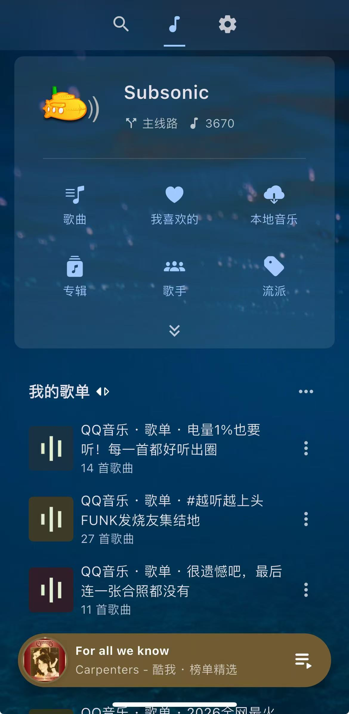

<div align="center">

# 🎵 MusicHub · 音乐汇

**多音源音乐服务，用你喜欢的播放器听歌。**

网易云 · QQ 音乐 · 酷我 · 酷狗 · 咪咕

[Docker 一键部署](#docker-一键部署) · [连接播放器](#连接播放器) · [功能与限制](#功能与限制) · [日常管理](#日常管理)


</div>

MusicHub 是一个自托管音乐服务，通过 **Subsonic 1.16.1 兼容 API**，把五个音源的榜单、公开歌单和搜索结果提供给音流等播放器。服务运行在 NAS、服务器或电脑的 Docker 中，手机只需填写地址和服务账号。

**仅支持平台允许免费收听的完整歌曲，不支持会员及付费歌曲，不解锁或绕过会员权限。** 使用匿名公开接口，不需要配置平台 Cookie。歌曲是否可播仍受地区、平台权限、网络和接口状态影响。

## 使用效果

<p align="center">
  
</p>

截图为客户端连接后的效果。MusicHub 本身提供 API，没有独立网页播放器；歌曲数量和公开歌单会随后台采集、权限检查与平台状态变化。

## 工作方式

```text
网易云 / QQ / 酷我 / 酷狗 / 咪咕
                ↓
  MusicHub：采集、搜索、权限过滤、按需缓存
                ↓  Subsonic API
       音流等兼容 Subsonic 的客户端
```

| 项目 | 说明 |
| --- | --- |
| 客户端服务类型 | **Subsonic**，不要选择 Navidrome |
| 协议 | Subsonic API 1.16.1；支持 JSON / XML、GET / 表单 POST |
| 认证 | 服务独立账号；支持密码和 `md5(password + salt)` token |
| 默认端口 | `8766` |
| API 路径 | `/rest/`，通常由客户端自动补全 |
| OpenSubsonic 扩展 | 仅声明已实现的 `songLyrics` 第 1 版 |
| 持久化 | SQLite、账号、收藏和播放记录保存在 Docker 数据卷 |

## Docker 一键部署

需要已安装 Docker。预构建镜像支持 **Linux amd64 / arm64**，适用于常见 x86 NAS、云服务器和 ARM64 设备。macOS / Windows 可使用 Docker Desktop。

复制下面整段命令执行：

```bash
docker run -d \
  --name music-hub \
  --restart unless-stopped \
  --init \
  -p 8766:8766 \
  -v music-hub-data:/experiment/data \
  --read-only \
  --tmpfs /tmp:rw,noexec,nosuid,size=32m,mode=1777 \
  --memory 256m --memory-swap 256m \
  --pids-limit 128 \
  --cap-drop ALL \
  --security-opt no-new-privileges:true \
  --log-opt max-size=5m --log-opt max-file=2 \
  -e TZ=Asia/Shanghai \
  ghcr.io/quyanchun/music-hub:latest
```

首次运行会自动拉取镜像、创建数据卷并生成服务账号。查看账号：

```bash
docker exec music-hub cat /experiment/data/credentials.json
```

输出中的 `username` 和 `password` 填到客户端中。这是 MusicHub 的账号，与 NAS 系统账号、音乐平台账号无关。请保存好这份凭据，不要上传到 GitHub。

查看启动状态：

```bash
docker ps --filter name=music-hub
curl http://127.0.0.1:8766/health
```

健康接口返回 `{"service":"music-hub","status":"ok"}` 即说明 API 已启动。首次采集在后台进行，健康检查通过时曲库可能仍为空，稍后在客户端刷新即可。

### Docker Compose

```bash
git clone https://github.com/quyanchun/music-hub.git
cd music-hub
docker compose up -d
docker compose exec music-hub cat /experiment/data/credentials.json
```

Compose 会使用相同的预构建镜像，自动创建持久化数据卷。可在 `compose.yaml` 同目录新建 `.env` 调整绑定地址或端口：

```dotenv
# 本机反向代理使用 127.0.0.1；默认 0.0.0.0 允许局域网访问。
MUSICHUB_BIND=0.0.0.0
MUSICHUB_PORT=8766
```

例如端口已被占用，将 `MUSICHUB_PORT` 改为 `18766` 后重新执行 `docker compose up -d`，客户端地址也改用 `18766`。

### 从源码构建

不方便拉取 GHCR 镜像时，可下载源码本地构建。Dockerfile 直接使用官方 Python 基础镜像，无需其他私有镜像或本项目早期的音乐站服务。

```bash
git clone https://github.com/quyanchun/music-hub.git
cd music-hub
docker compose up -d --build
```

构建过程需要能访问 Docker Hub、Debian 软件源和 PyPI。

## 连接播放器

以 [音流](https://music.aqzscn.cn/docs/services/) 为例：

1. 添加音乐服务，类型选择 **Subsonic**。
2. 服务器地址填写 `http://你的服务器IP:8766`。只填到端口，不追加 `/rest/`。
3. 用户名、密码填写上面 `credentials.json` 中的值。
4. 保存并登录，在歌曲、专辑、歌手、歌单或搜索页浏览音乐。

| 访问场景 | 地址示例 |
| --- | --- |
| 与客户端在同一台电脑 | `http://127.0.0.1:8766` |
| 手机访问同一局域网的 NAS / 电脑 | `http://你的NAS或电脑IP:8766` |
| 域名与 HTTPS 反向代理 | `https://music.example.com` |

手机上的 `127.0.0.1` 指手机自身，请使用运行 Docker 的设备 IP。公网使用建议配置 HTTPS，并按需开放端口；MusicHub 不会自动修改防火墙或配置路由器转发。反向代理应把完整路径转发到 `http://127.0.0.1:8766`，在线搜索可能需要约 25 秒，建议请求超时至少 60 秒。

也可使用其他支持 Subsonic 的客户端，兼容性以实际接口为准。不要选 Navidrome 专有服务类型，MusicHub 没有实现它的登录 API。

## 功能与限制

| 功能 | 当前行为 |
| --- | --- |
| 五源在线搜索 | 并行搜索五个平台，验证完整音频后入库；支持关键词、分页和按音源搜索 |
| 榜单 | 每个平台三张榜单，共 15 张，保留各平台的排名顺序 |
| 公开歌单 | 自动采集各源公开推荐歌单，过滤会员 / 试听与不可用曲目后展示 |
| 随机推荐 | 后台持续补充发现池，跨源同曲去重，尽量减少近期重复推荐 |
| 浏览 | 歌曲、歌手、专辑、流派、音源文件夹 |
| 播放与下载 | 按需缓存，支持 HEAD、Range、拖动和断点读取 |
| 歌词与封面 | 同步歌词、封面、相似歌曲和热门歌曲 |
| 使用记录 | 收藏、评分和播放次数持久化，重启后保留 |

- 公开歌单每源最多选取 12 张，每张最多读取 300 首；匿名接口可能只返回部分歌曲。空歌单不显示，显示的数量是当前通过过滤的数量。
- 榜单和公开歌单约每 6 小时刷新；发现池约每 2 小时补充。首次初始化需要一段时间，不会预下载全库音频。
- 新关键词搜索最长约 25 秒；某音源失败时返回其他音源与已有库内结果。云服务器可能被平台限流，接口适配不代表所有源始终可播。
- QQ 音频取链目前使用适配器中的第三方解析通道，最终音频地址限定为 QQ 自有域名；该通道变化也会影响可用性。
- 搜索结果缓存约 5 分钟；空关键词、`*` 和 `""` 浏览已收录曲库，不发起全网搜索。
- 歌单为只读，不支持创建 / 编辑个人歌单；当前为单账号服务，不支持多用户、服务端播放队列、转码和完整 Navidrome API。
- 推荐与相似歌曲基于公开歌单、元数据和库内记录，不是各平台登录后的私人每日推荐。

### 存储与资源

默认容器内存上限 **256 MiB**，不使用 swap；Docker 引擎本身另占资源。并发探测经过限制，忙时可能需要等待。

音频缓存目标约 512 MiB / 24 小时，封面约 64 MiB / 24 小时，日志按 5 MiB × 2 轮转。启动及每 30 分钟维护一次；正在使用的文件和数据库 WAL 可能临时超出目标。磁盘剩余低于 1 GiB 时暂停新增缓存，建议至少预留 2 GiB 空间。

SQLite 主库上限 128 MiB；收藏、评分和播放记录保留。超过 30 天未使用且不属于榜单、发现池或用户记录的临时索引会清理，旧队列可能需要重新搜索。数据卷含账号和使用记录，应定期备份。

## 日常管理

以下命令适用于上述 `docker run` 部署；Compose 部署可在源码目录使用 `docker compose logs`、`restart`、`stop` 等对应命令。

```bash
# 查看日志与资源
docker logs --tail 100 music-hub
docker stats --no-stream music-hub

# 重启 / 停止
docker restart music-hub
docker stop music-hub
```

### 更新

Compose 部署：

```bash
docker compose pull
docker compose up -d
```

`docker run` 部署：

```bash
docker pull ghcr.io/quyanchun/music-hub:latest
docker stop music-hub
docker rm music-hub
# 然后重新执行上面的 docker run 命令，继续使用 music-hub-data 数据卷。
```

更新前建议备份数据。删除容器不会删除命名数据卷；**不要执行 `docker compose down -v` 或删除数据卷**，否则账号、收藏和曲库会丢失。源码构建用户用 `git pull` 后执行 `docker compose up -d --build`。

本项目直接更新主分支及 `latest` 镜像，不依赖 GitHub Releases。镜像同时附带 `sha-提交号` 标签，便于固定构建。

### 备份

`docker run` 部署可以先停止服务，再复制完整数据目录，确保 SQLite 与 WAL 处于一致状态：

```bash
docker stop music-hub
docker cp music-hub:/experiment/data ./music-hub-backup
docker start music-hub
```

备份目录含密码，请妥善保存。恢复时停止服务，把备份内容放回原数据卷，并确保目录可由容器用户 `10001:10001` 读写。

## 开发与验证

需要 Python 3.12+ 和 FFmpeg（包括 `ffprobe`）：

```bash
python3 -m venv .venv
. .venv/bin/activate
pip install -r requirements.txt
python -m unittest discover -p 'test_*.py'
python service.py --host 127.0.0.1 --port 8766 --data ./data
```

单元测试使用隔离临时目录和模拟平台响应。真实部署可在容器内运行：

```bash
docker exec music-hub python /experiment/verify_live.py
# 额外验证五源真实播放（受上游网络、地区和平台权限影响）
docker exec music-hub python /experiment/verify_live.py --playback
```

验证脚本从私有数据目录读取账号，不打印密码；首次采集尚未完成或后台正在改变曲库时，可等待稳定后再验证。GitHub Actions 在 amd64 / arm64 上运行测试，并在主分支检查通过后构建和推送双架构镜像。

## 项目来源与许可证

MusicHub 从早期独立音乐服务实验整理而来，服务端不依赖其他项目源码。音乐平台适配器包含 [music-dl](https://github.com/0xHJK/music-dl) 的代码快照，保留上游作者信息和 MIT 许可证，详见 [第三方说明](THIRD_PARTY_NOTICES.md)。[Folia 音乐站](https://github.com/quyanchun/folia-free) 是同一音源方向的桌面播放器项目，两者可以分别运行。

项目代码采用 [MIT](LICENSE) 许可证。音乐内容版权属于各平台及权利人，请遵守相关服务条款和内容使用要求。
